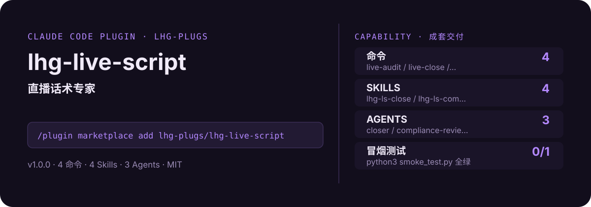

<!-- About 简介（推送后填写到仓库 About 栏）：
直播话术专家：品类输入→开播 3 秒留人钩子→留人/转粉/逼单五段式脚本→逼单倒计时话术→违禁词/极限词合规审计，一场直播的话术一次写完。 ｜ 一键安装：/plugin marketplace add lhg-plugs/lhg-live-script
-->
<!-- topics（推送后打）：claude-code, claude-plugin, agent-skills, live-streaming, livestream, sales-script, ecommerce, hook -->

<p align="center">
  
</p>

> **一句话介绍**：直播话术专家：品类输入→开播 3 秒留人钩子→留人/转粉/逼单五段式脚本→逼单倒计时话术→违禁词/极限词合规审计，一场直播的话术一次写完。

**一键安装**：在 Claude Code 里运行

```bash
/plugin marketplace add lhg-plugs/lhg-live-script
/plugin install lhg-live-script@lhg-plugs
```

## 它能帮你做出什么

- **冒烟测试**：`python3 smoke_test.py` 本次实测通过 0/1 项（见仓库自带测试输出）。

## 它是什么

`lhg-live-script` 是一个 Claude Code 插件（plugin 为主、skill 为辅）：

- **4 个命令**（小白入口）：`live-audit` 话术自检、`live-close` 逼单话术单发、`live-hook` 开播钩子单发、`live-script` 完整开播脚本
- **4 个平台中立 skill**（方法论，可移植到豆包/Workbuddy 等 agent 平台）：lhg-ls-close, lhg-ls-compliance, lhg-ls-hook, lhg-ls-structure
- **3 个专家 agent**：closer, compliance-reviewer, hook-writer
- **1 个 hooks**（`hooks/`：validate_script_before_deliver.py），关键操作前自动把关

## 为什么是它

不是一个 prompt，而是一套互相兜底的机制：

1. **硬门，不是提醒**：hooks 在关键操作前自动拦截或警告（见 `hooks/`），而不是只在文档里写一句"请注意"。
2. **方法论沉淀在 skill 里**：流程、检查清单、口径都写在 `skills/` 的方法论里，命令只是入口；换个 agent 平台也能复用同一套做法。
3. **可验，不是可信**：`fixtures/` 备有坏/好对照用例，`smoke_test.py` 一键验证，规则有没有生效、自己跑一遍就知道。

## 快速上手

```bash
# 1. 安装（Claude Code 里运行）
/plugin marketplace add lhg-plugs/lhg-live-script
/plugin install lhg-live-script@lhg-plugs

# 2. 完整开播脚本：品类+产品输入→五段式结构→逐段话术→逼单穿插→合规审计，一场 2
/lhg-live-script:live-script 美妆 面霜/精华 --minutes 120
```

| 命令 | 作用 | 示例 |
|---|---|---|
| `/lhg-live-script:live-audit` | 话术自检：对交付目录跑 32 条确定性规则（违禁词 5 类+结构完整性+口语化），blocker 清零才算过。 | `/lhg-live-script:live-audit ./delivery/ --strict` |
| `/lhg-live-script:live-close` | 逼单话术单发：产品+价格→锚点对比+倒计时三阶+下单引导→异议处理 5 问，一款产品的完整逼单话术卡。 | `/lhg-live-script:live-close 面霜 299 59.9` |
| `/lhg-live-script:live-hook` | 开播钩子单发：品类+产品→3 条 3 秒留人钩子（福利/悬念/痛点/身份选 3 类）→三问质检→用户拍板。 | `/lhg-live-script:live-hook 食品 坚果礼盒` |
| `/lhg-live-script:live-script` | 完整开播脚本：品类+产品输入→五段式结构→逐段话术→逼单穿插→合规审计，一场 2 小时直播的话术一次写完。 | `/lhg-live-script:live-script 美妆 面霜/精华 --minutes 120` |

## 什么时候用 / 什么时候不用（FAQ）

**什么时候用：**

- 你需要话术自检时 → 用 `/lhg-live-script:live-audit`
- 你需要逼单话术单发时 → 用 `/lhg-live-script:live-close`
- 你需要开播钩子单发时 → 用 `/lhg-live-script:live-hook`

**什么时候不用：**

- 你只需要其中一个零散能力时 → 本插件是成套流程，单点需求用更轻量的 skill 更合适
- 你希望 AI 完全自由发挥、不接受任何自查与硬门时 → 它的规则审计与 hooks 会介入（可关，但那就别装它）
- 你的场景不在上面命令表覆盖范围内时 → 先看命令表，没有对应命令就别硬套

## 目录结构

```
lhg-live-script/
├── smoke_test.py          # 一键冒烟测试
├── ATTRIBUTION.md         # 灵感来源与许可声明
├── LICENSE                # MIT
├── README.md              # 本文件
├── .claude-plugin/
├── agents/
├── commands/
├── fixtures/
├── hooks/
├── scripts/
├── skills/
```

## 自检与反馈

本插件自带质检：每次使用后可跑 `python3 smoke_test.py` 一键验证。

发现 bug 或有改进建议，以 `[QC] <一句话问题>` 为标题提交到 https://github.com/lhg-plugs/lhg-live-script/issues，正文写清"复现步骤 → 实际表现 → 期望表现"。

同门插件见 [lhg-plugs](https://github.com/lhg-plugs)，86 个插件的完整矩阵在 [marketplace](https://github.com/lhg-plugs/marketplace) 维护。

## 出品：刘洪光

本插件由真人出镜 IP「刘洪光」（安徽合肥）出品，归属 [lhg-skills](https://github.com/lhg-skills)。

- GitHub 主页：https://github.com/lhg-skills —— 全部 skill 开源在此，欢迎 star
- 抖音：搜「刘老师讲AI实战」
- 微信：lhgsmsw
